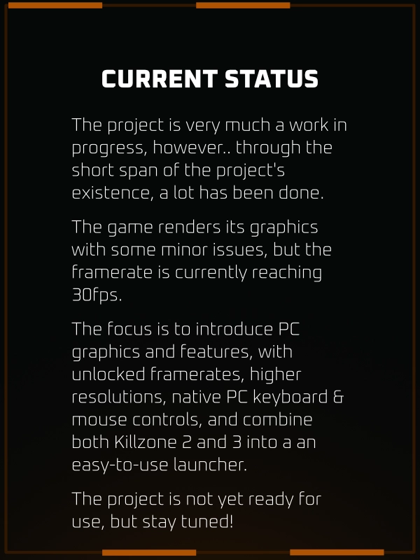

## Note

**This repository contains no game code or data.** Everything game-derived is
generated on your machine from your own **legally** obtained copy.


## Components

| Part      | How it runs                                                                                                                 |
| --------- | --------------------------------------------------------------------------------------------------------------------------- |
| PPU (CPU) | Statically recompiled: all reachable code (2.9M instructions, 49k functions) becomes C, including FPU and VMX/AltiVec       |
| SPU       | Statically recompiled from the EBOOT and from SPU code captured at run time; float, shuffle and rotate instructions use SSE |
| SPURS     | Job-manager workloads run on up to 5 host threads each; task sets, events and mailboxes are emulated                        |
| RSX (GPU) | Translated to Direct3D 11: shaders to HLSL (cached on disk), render-target cache, vertex decoding on the GPU                |
| OS        | Threads, synchronisation primitives, memory, file system (`/dev_bdvd` mapped onto your dump), save data                     |
| Input     | XInput controller mapped to a DualShock 3                                                                                   |
| Audio     | Not yet: timing works, no sound output                                                                                      |

## Building

Requirements: Python 3.10+, CMake, Ninja, LLVM-MinGW (clang), and RPCS3 with
PS3 firmware installed (used once, to decrypt `EBOOT.BIN`).

```
winget install Python.Python.3.13 Kitware.CMake Ninja-build.Ninja MartinStorsjo.LLVM-MinGW.UCRT
cmake -B build -G Ninja -DCMAKE_C_COMPILER=clang -DCMAKE_CXX_COMPILER=clang++ ^
      -DKZ2_DUMP="E:/PS3 Dumps/_BCES00081-[Killzone2]" -DRPCS3_EXE="E:/RPCS3/rpcs3.exe"
ninja -C build
build\kz2.exe
```

Configuring runs the recompiler (`tools/recomp`); the build then compiles the
generated code. SPU code the game loads at run time is captured to
`build/spu_cache/` and compiled natively on the next build, so the first runs
are slower. `kz2.exe --dump <dir>` overrides the dump location; saves go to
`build/data/`.

## Debugging

In the game window:

| Key   | Effect                                                                                                    |
| ----- | --------------------------------------------------------------------------------------------------------- |
| `F12` | Frame capture: logs every draw, saves render targets, pass inputs/outputs and translated shaders as files |
| `F9`  | Frame timeline for 4 frames (RSX, SPU and main-thread waits), without the capture's file dumps            |
| `F11` | Toggle environment (cube-map) reflections                                                                 |

Environment variables:

| Variable                             | Effect                                                                                          |
| ------------------------------------ | ----------------------------------------------------------------------------------------------- |
| `KZ2_WATCHDOG=<sec>`                 | Periodically print every guest thread's current OS call and an RSX method histogram             |
| `KZ2_PROFILE=<sec>`                  | Sample all threads: CPU time per thread and hot spots (`KZ2_PROFILE_THREADS=name,...` for more) |
| `KZ2_TRACE_HLE=1`, `KZ2_TRACE_RSX=1` | Log the first calls of every implemented import / the start of the RSX command stream           |
| `KZ2_DUMP_FRAME=N`, `KZ2_DUMP_RT=N`  | Write every RSX method of frame N to `frame.txt` / save its render targets                      |
| `KZ2_DUMP_SHADERS=1`                 | Write all generated HLSL to `shaders/` (failed compiles are always written)                     |
| `KZ2_LOG_DRAWS=N`, `KZ2_LOG_ATTRS=d` | Per-draw state for frame N; vertex attributes and textures of draw d                            |
| `KZ2_SKIP_DRAWS=a,b`                 | Skip draw indices (bisecting rendering bugs)                                                    |
| `KZ2_SPU_NATIVE=0`                   | Run all SPU code in the interpreter                                                             |

Most rendering and performance changes also have a switch to turn them off for
comparison (e.g. `KZ2_CPU_VERTEX`, `KZ2_NO_SHADER_CACHE`, `KZ2_NO_MIPS`); they
are documented where they are read in `runtime/src`.

## How it works

```
EBOOT.BIN ──rpcs3 --decrypt──▶ EBOOT.elf ──tools/recomp──▶ build/generated/ ──clang──▶ kz2.exe
                                                                                ▲
                                                               runtime/ (OS, libraries, RSX, SPU)
```

**`tools/recomp`** (Python)
- `elf.py`: PS3 ELF segments, `.opd` function descriptors, TLS, import stubs.
- `nid.py`: imports are identified by NID = SHA-1(name + salt)[0:4]. Names are
  recovered by hashing strings found in your `rpcs3.exe`; no database is shipped.
- `ppc.py`, `analyze.py`, `codegen.py`: PPU decoding, function discovery (from
  every `.opd` entry and `bl` target, with jump-table recovery), and one C
  function per guest function.
- `spu.py`, `spu_cache.py`: SPU modules (task ELFs, job binaries, captured code)
  to C++, sharing instruction semantics with the interpreter.

**`runtime/`** (C++)
- Guest memory is a 4 GiB reservation committed on demand. Imports are bound
  by writing function descriptors into the game's stub slots; calls land in
  `hle_*.cpp`.
- `rsx/`: the RSX command stream is translated to Direct3D 11 draws; vertex
  and fragment programs become HLSL.
- `spu/`, `spurs_*.cpp`: SPU threads, DMA and the SPURS kernel; recompiled SPU
  code is mapped when its image is loaded into local store.

## Next technical steps

1. Remaining rendering differences from the PS3.
2. Separate the game's simulation tick from its frame rate (the game advances
   a fixed step per frame and caps itself at 30 fps).
