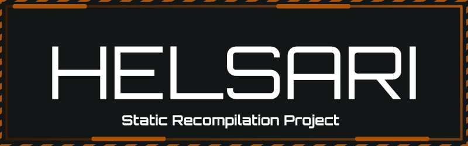
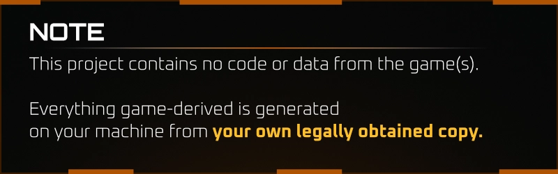

<p align="center" width="100%">
      
</p>  
<p align="center" width="100%">
      
</p>
<p align="center" width="100%">
      <strong>Unofficial Static Recompilation project for Killzone 2 and Killzone 3</strong>
</p>  
<div align="center">
  <p>Mouse & Keyboard Support</p>
  <p>PC Options</p>
  <p>Graphics Settings</p>
  <p>Unlocked Framerate</p>
</div>


### Architecture & Subsystems

| Subsystem Component | Implementation Method & Status |
| :--- | :--- |
| **PPU (CPU)** | Statically recompiled: all reachable code (2.9M instructions, 49k functions) becomes native C, including full FPU and VMX/AltiVec support. |
| **SPU** | Statically recompiled from the EBOOT and from SPU code captured at run time; float, shuffle, and rotate instructions utilize host SIMD hardware. |
| **SPURS** | Job-manager workloads run on up to 5 host threads each; task sets, events, and mailboxes are abstractly emulated. |
| **RSX (GPU)** | Translated directly to Direct3D 11: shaders are recompiled to HLSL (cached locally on disk), utilizing a render-target cache and on-GPU vertex decoding. |
| **OS Layer** | System threads, synchronization primitives, memory maps, save data virtualization, and file system abstractions (`/dev_bdvd` mapped onto the user's local dump). |
| **Input** | Native XInput controller mapped directly to virtual DualShock 3 bindings; features 1:1 raw mouse look handling while on foot. |
| **Audio** | Proprietary `cellAudio` ports mixed down into native 7.1 surround sound audio, processed through the low-latency WASAPI pipeline. |

## Building

Requirements: Python 3.10+, CMake, Ninja, Visual Studio Build Tools with its
Clang component, and RPCS3 with PS3 firmware installed (used once, to decrypt
`EBOOT.BIN`). The game needs a CPU with AVX2. Microsoft's Clang is signed, so
Windows Smart App Control allows it. The build still has LLVM-MinGW settings, but
Smart App Control can block that unsigned compiler, and they are untested since
the switch.

```
winget install Python.Python.3.13 Kitware.CMake Ninja-build.Ninja
winget install Microsoft.VisualStudio.BuildTools --override "--quiet --wait --norestart --add Microsoft.VisualStudio.Workload.VCTools --add Microsoft.VisualStudio.Component.VC.Tools.x86.x64 --add Microsoft.VisualStudio.Component.VC.Llvm.Clang --add Microsoft.VisualStudio.Component.Windows11SDK.26100"
set LLVM=C:/Program Files (x86)/Microsoft Visual Studio/18/BuildTools/VC/Tools/Llvm/x64/bin
cmake -B build -G Ninja "-DCMAKE_C_COMPILER=%LLVM%/clang.exe" "-DCMAKE_CXX_COMPILER=%LLVM%/clang++.exe" ^
      -DKZ2_DUMP="E:/PS3 Dumps/_BCES00081-[Killzone2]" -DRPCS3_EXE="E:/RPCS3/rpcs3.exe"
ninja -C build
build\helsari2.exe
```

Configuring runs the recompiler (`tools/recomp`); the build then compiles the
generated code. SPU code the game loads at run time is captured to
`build/spu_cache/` and compiled natively on the next build, so the first runs
are slower; so are entry points of compiled programs that are only reached
through computed jumps (`spu_cache/entries.txt`). `helsari2.exe --dump <dir>` overrides
the dump location; saves go to `build/data/`.

## Mouse look

Looking around with the mouse on foot is 1:1: raw input, with no acceleration or
smoothing, updated every rendered frame.

The game's logic runs at a fixed 15 Hz with an interpolated camera, so input
through its look code reaches the screen late and blended. With the mouse, the
player's rotation is written every rendered frame instead, and the view is
corrected to match, so the camera, the character and the aim turn together. Using
a controller hands the look back to the game until the mouse moves again.

The viewmodel has its own transform at draw time: each part follows the game's
pose smoothly, which removes the 15 Hz steps, and its sway is the same size at any
pitch. **Options > Gameplay > Viewmodel Sway Multiplier** sets how much sway there
is (0.25x to 2x).

`KZ2_MOUSE_SENS=<n>` sets the sensitivity, and `KZ2_MOUSE_OFF=1` turns all of this off.

## Debugging

In the game window:

| Key   | Effect                                                                                                    |
| ----- | --------------------------------------------------------------------------------------------------------- |
| `F12` | Frame capture: logs every draw, saves render targets, pass inputs/outputs and translated shaders as files |
| `F9`  | Frame timeline for 4 frames (RSX, SPU and main-thread waits), without the capture's file dumps            |
| `F11` | Toggle environment (cube-map) reflections                                                                 |

Environment variables:

| Variable                             | Effect                                                                                          |
| ------------------------------------ | ----------------------------------------------------------------------------------------------- |
| `KZ2_WATCHDOG=<sec>`                 | Periodically print every guest thread's current OS call and an RSX method histogram             |
| `KZ2_PROFILE=<sec>`                  | Sample all threads: CPU time per thread and hot spots (`KZ2_PROFILE_THREADS=name,...` for more) |
| `KZ2_TRACE_HLE=1`, `KZ2_TRACE_RSX=1` | Log the first calls of every implemented import / the start of the RSX command stream           |
| `KZ2_DUMP_FRAME=N`, `KZ2_DUMP_RT=N`  | Write every RSX method of frame N to `frame.txt` / save its render targets                      |
| `KZ2_DUMP_SHADERS=1`                 | Write all generated HLSL to `shaders/` (failed compiles are always written)                     |
| `KZ2_LOG_DRAWS=N`, `KZ2_LOG_ATTRS=d` | Per-draw state for frame N; vertex attributes and textures of draw d                            |
| `KZ2_SKIP_DRAWS=a,b`                 | Skip draw indices (bisecting rendering bugs)                                                    |
| `KZ2_SPU_NATIVE=0`                   | Run all SPU code in the interpreter                                                             |
| `KZ2_DEBUG_PS=<hash>`, `KZ2_DEBUG_EXPR` | Replace one pixel shader's output with an HLSL expression                                    |
| `KZ2_FP_WORDS=1`                     | Put raw fragment program words into the generated HLSL                                          |

Most rendering and performance changes also have a switch to turn them off for
comparison (e.g. `KZ2_CPU_VERTEX`, `KZ2_NO_SHADER_CACHE`, `KZ2_NO_MIPS`); they
are documented where they are read in `runtime/src`.

## How it works

```
EBOOT.BIN ──rpcs3 --decrypt──▶ EBOOT.elf ──tools/recomp──▶ build/generated/ ──clang──▶ helsari2.exe
                                                                                ▲
                                                               runtime/ (OS, libraries, RSX, SPU)
```

**`tools/recomp`** (Python)
- `elf.py`: PS3 ELF segments, `.opd` function descriptors, TLS, import stubs.
- `nid.py`: imports are identified by NID = SHA-1(name + salt)[0:4]. Names are
  recovered by hashing strings found in your `rpcs3.exe`; no database is shipped.
- `ppc.py`, `analyze.py`, `codegen.py`: PPU decoding, function discovery (from
  every `.opd` entry and `bl` target, with jump-table recovery), and one C
  function per guest function.
- `spu.py`, `spu_cache.py`: SPU modules (task ELFs, job binaries, captured code)
  to C++, sharing instruction semantics with the interpreter.

**`runtime/`** (C++)
- Guest memory is a 4 GiB reservation committed on demand. Imports are bound
  by writing function descriptors into the game's stub slots; calls land in
  `hle_*.cpp`.
- `rsx/`: the RSX command stream is translated to Direct3D 11 draws; vertex
  and fragment programs become HLSL.
- `spu/`, `spurs_*.cpp`: SPU threads, DMA and the SPURS kernel; recompiled SPU
  code is mapped when its image is loaded into local store.

## Next technical steps

1. Hold 60 fps in the busiest scenes. Measured: post-processing is not what limits
   them (turning most of it off gains nothing), so find what the main thread and the
   RSX wait for (`tools/timeline.py` reads the F9 timeline).
2. Remaining rendering differences from the PS3.
